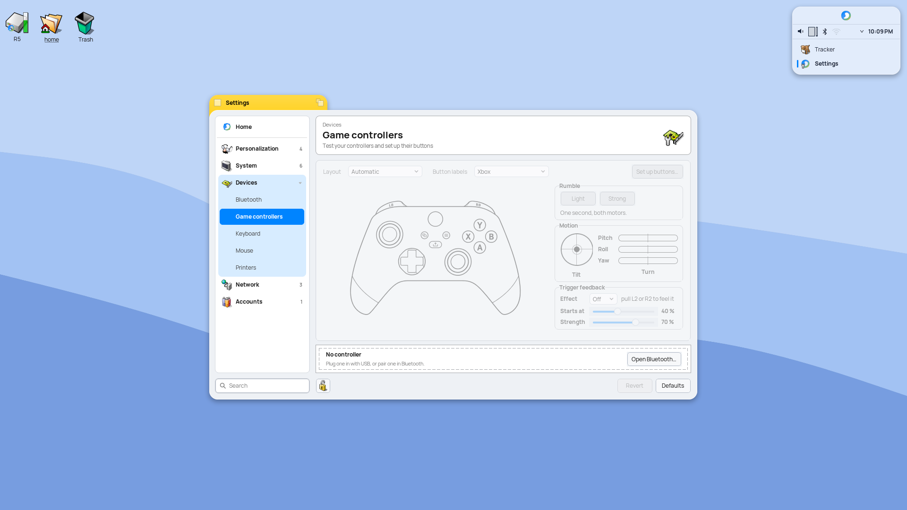

# R5 Operating System

**A desktop with a little more attitude.**

Meet R5. An independent desktop operating system built on
[Haiku](https://www.haiku-os.org/), with a fresh perspective on what a
desktop can be.

R5 brings together the things we love about a great desktop: speed,
simplicity and a sense of control, with a modern look, better
hardware support and the features you need to make yourself at home.

No unnecessary clutter. No complicated nonsense. Just a desktop that's a
pleasure to use, with plenty of personality of its own.

<p align="center"></p>

## At a glance

- **Your graphics chip finally has a job.** A sleek new R5 window frame,
  soft shadows, frosted glass and smooth animations, with every window
  drawn on the GPU (thanks, Skia). Pick Quiet, Balanced or Glassy. Dark
  mode? Obviously.
- **Speaks Vulkan and OpenGL, no Linux required.** RADV for Vulkan,
  OpenGL on top. Yes, really.
- **Settings that don't send you on a treasure hunt.** Display,
  Appearance, Wi-Fi, Network, Bluetooth, Notifications, Game controllers
  and more, all in one window. Change it, see it, done.
- **Your account, your stuff.** User accounts, a sign-in screen, screen
  locking and separate home folders.
- **Wi-Fi 6 and WPA3.** On selected cards, plus IPv6, network discovery
  and shared folders with Windows.
- **Print it. Play it.** AirPrint and IPP printing, and play your music
  on AirPlay 1 speakers.
- **Game controllers? So welcome.** PlayStation, Xbox, Nintendo and
  8BitDo, over USB or Bluetooth. Rumble and DualSense trigger effects
  included. No, we're not kidding.
- **Sound, sorted.** Steadier USB audio, HDMI and surround, lower
  latencies when you want them, and MIDI 2.0 support with a built-in
  MIDI monitor.
- **Tuned for 64-bit processors.** Optimised for modern 64-bit AMD and
  Intel processors: AVX2 and FMA where your CPU has them, a quicker
  start, and fast cores doing the fast work. And we're not done tuning.
- **Your Haiku apps? Still here.** Same APIs, same apps, no drama.

Tried and tested on a real AMD Ryzen 5 5625U laptop. Other computers get
the same desktop drawn in software. VirtualBox and QEMU are welcome too.

## A desktop with personality

**Same soul. Whole new attitude.**

Floating windows in a sleek new R5 frame, soft shadows, frosted glass,
animations that feel just right, and your GPU doing the heavy lifting.
This isn't a desktop pretending to be modern. Want it subtle or full
glass? Quiet, Balanced or Glassy: your call. And every setting lives in
one tidy window. Change something, see it straight away, and change your
mind whenever you like.

## Make yourself at home

**Your computer. Your space. Your rules.**

Everyone gets their own user account, their own files and their own
settings. Stepping away? Lock the screen. Done for the day? Log out. The
important system settings stay behind a lock, and an administrator's
password opens it.

## Everything a little more connected

**Your devices should get along. R5 plays matchmaker.**

Wi-Fi 6 with WPA3 on selected cards, modern IPv4 and IPv6, and DNS your
way. Find other computers nearby, open their shared folders, print with
AirPrint or IPP, and send your music to AirPlay 1 speakers. Plug in or
pair your favourite game controller, feel the rumble, and pick up where
you left off.

## Sound that feels right

**From a quick video to a serious session.**

More reliable USB audio, better mixing, and HDMI and surround that
behave. Picky about latency? Choose Normal, Low latency or Pro audio.
Music makers get MIDI 2.0 and a MIDI monitor that shows exactly what
your keyboard is saying.

## More of your hardware, put to work

**A modern desktop deserves modern graphics.**

Native Vulkan, OpenGL on top, and a desktop and windows that are finally
drawn on the GPU. No Linux kernel required. Something not right? Safe
mode in the boot menu always brings back the classic drawing. For now
the GPU path is tested on specific hardware; other hardware gets the
same look in software, just with your processor working a bit harder.

## Under the hood

**The little things add up.**

R5 is optimised for modern AMD64 processors, and we keep at it. It loves
AMD and Intel CPUs, loads AMD microcode updates, and uses AVX2 and FMA
when your CPU has them. Fast cores get the fast work, idle cores get to
sleep, and start-up and shutdown are quicker. You'll probably never
notice any of it. That's rather the point.

## Bring R5 along for the ride

**At home on real hardware. Happy to visit a virtual machine.**

Want a spin without giving up a whole computer? R5 comes with VirtualBox
Guest Additions. AMD64 is home for now. ARM64 and RISC-V are on the
horizon.

## What's coming next?

**We're not done dreaming. Not even close.**

**Sharper on every screen.** With windows drawn on the GPU, the next
step is HiDPI: REAL scaling that keeps text and icons crisp on
high-resolution displays.

**A more modern Deskbar.** We've been redesigning Deskbar… and oh boy,
you're going to love this.

**Bluetooth that keeps up.** You can already pair your mouse, keyboard
or headset in Settings, and soon a lot more. Next up is LE Audio, the
new standard for wireless earbuds and headphones, with better sound at
lower power, and Auracast, so you can tune in to shared audio streams.

**More hardware.** GPU drawing on more graphics chips, starting with
Intel, and Wi-Fi 6 on more cards than MediaTek alone.

These are plans, not features of the current build. But they're a good
glimpse of where we're heading.

## Project status

**A work in progress. And very much alive.**

R5 is under active development. There's no public release just yet, but
development is moving forward.

-   **Current build:** 10066
-   **Version:** 2026.1-dev
-   **Primary architecture:** AMD64
-   **Minimum processor:** a 64-bit AMD or Intel CPU with x86-64-v2
    (Intel Nehalem, AMD Bulldozer or newer)

Some features are still evolving, and hardware support varies. GPU
drawing is so far only tested on the AMD Ryzen 5 5625U system
mentioned above. Vulkan and OpenGL support are also under active
development.

## A note about R5 and Haiku

R5 is built on [Haiku](https://www.haiku-os.org/), but it is an
independent project. It is not an official Haiku distribution, nor is it
affiliated with or endorsed by the Haiku Project. See
[`distro/DISCLAIMER.txt`](distro/DISCLAIMER.txt).

The name R5 is a nod to the history of BeOS R5. It does not mean that R5
is BeOS, a continuation of BeOS, or an official Haiku release.

Haiku and BeOS names and logos belong to their respective owners.

## Our relationship with Haiku

R5 is built on Haiku, and we regularly bring in fixes and improvements from its source code. R5 is an independent project, though, and changes made specifically for R5 stay with R5.

There's one important distinction worth making: R5 development uses AI-assisted tools. The Haiku Project does not accept contributions created or modified using AI, so R5's changes are not submitted upstream.

## For developers

Everything below is for people who build R5 or work on it.

### Trying it

R5 Operating System is built from source; there are no downloads yet. After a build (see below) you can:

- **Run it in VirtualBox.** Use [`scripts/run-vbox-r5.ps1`](scripts/run-vbox-r5.ps1) on Windows, and see [`docs/vbox.md`](docs/vbox.md). With a bridged network adapter this is the way to test real home-network features such as IPv6 and printer discovery.
- **Run it in QEMU.** Use [`scripts/run-qemu-r5.sh`](scripts/run-qemu-r5.sh). QEMU's default user-mode network is not a real home network.
- **Boot it from USB.** Build the `r5-anyboot` image and write it to a USB stick. Check the target disk twice before writing.

### Building

Haiku does not build natively on Windows. Use Linux, or WSL with Ubuntu on Windows. Keep the checkout on the Linux file system (for example `~/Projects/R5OS`), not under `/mnt/c`: the Windows file system is case-insensitive and slow for this.

Install the build tools:

```bash
sudo apt update
sudo apt install git nasm autoconf automake texinfo flex bison gawk \
  build-essential unzip wget zip xorriso mtools python3 \
  zlib1g-dev libzstd-dev
```

The full list of what Haiku needs is in [`haiku/ReadMe.Compiling.md`](haiku/ReadMe.Compiling.md).

Get the sources and Haiku's build tools, and install `jam`:

```bash
git clone https://github.com/r5-operating-system/r5os.git ~/Projects/R5OS
cd ~/Projects/R5OS
git clone https://review.haiku-os.org/buildtools
make -C buildtools/jam
(cd buildtools/jam && ./jam0 -sBINDIR="$HOME/bin" install)
export PATH="$HOME/bin:$PATH"
```

Build an image:

```bash
./scripts/build-image.sh r5-raw
```

`build-image.sh` copies the R5 Operating System changes from `distro/` into the Haiku tree, configures the build on the first run, and runs `jam`. The result lands in `haiku/generated.x86_64/`.

| Profile | Use it for |
|---|---|
| `r5-raw` | A disk image for QEMU, or for converting to a VirtualBox disk |
| `r5-anyboot` | A bootable ISO or USB stick |
| `r5-vmware` | VMware |

### How the repository is organized

| Path | What it holds |
|---|---|
| `distro/` | Everything R5 Operating System adds or changes: version, What's new, artwork, apps, drivers and system components. These files are copied into the Haiku tree at build time. |
| `haiku/` | The Haiku source tree that R5 Operating System builds on. |
| `docs/r5book/` | The R5Book, a developer guide in the style of the Be Book. |
| `docs/` | Design notes and contracts: [roadmap](docs/ROADMAP.md), [graphics](docs/GRAPHICS.md), [multi-user](docs/MULTIUSER.md), [Settings](docs/SETTINGS.md), [icons](docs/ICONS.md), [shared libraries](docs/LIBR5.md), [licensing](docs/LICENSING.md), and more. |
| `scripts/` | Build, image, virtual-machine and tracker scripts. |
| `tracker/` | Which open Haiku tickets R5 Operating System has fixed. The overview is [`tracker/STATUS.md`](tracker/STATUS.md). |
| `tools/r5-befs/` | A small read-only BeFS reader for Windows. |
| `LICENSES/` | The unmodified license texts. |

### Licensing

R5 Operating System is **multi-license**:

- Files that come from Haiku keep their original license and copyright, mostly MIT.
- New files that R5 owns are MIT, so other Haiku-based systems can use them (since 12 Nov 2026). The R5 artwork and brand files stay GPL-3.0-or-later.
- Libraries and public headers that applications link or include are MIT, so any program can use them: the R5 libraries (`libr5icons`, `libr5ui`, `libr5admin`, `libr5wifi`, `libr5bt` and `libr5game`, listed in [`docs/LIBR5.md`](docs/LIBR5.md)), the R5 GPU interface header and the R5 DRM library.
- Third-party components keep their own licenses. They are listed in [`THIRD_PARTY_NOTICES.md`](THIRD_PARTY_NOTICES.md). Examples are the VirtualBox Guest Additions (GPL-3.0-only), the AMD firmware, Mesa and Skia (BSD-3-Clause).

The full policy is in [`docs/LICENSING.md`](docs/LICENSING.md). About R5 shows the licenses and credits on the system itself.

### Contributing

AI-assisted work is welcome here. It is held to the same bar as any other change: it has to build, boot and be tested before it counts as done. Before you start, read [`AGENTS.md`](AGENTS.md). It covers the development loop, the fixed parts of the system, versioning, and how to record changes.

- Pull requests target `main`.
- User-visible changes get a What's new entry in plain language. Technical details go in `CHANGELOG.md`.
- Use the name **R5 Operating System**, short **R5** (see "Name" in `AGENTS.md`). Do not use Haiku or BeOS names or logos on the image.

### Translations

R5's own programs are translated on [Weblate](https://hosted.weblate.org/projects/r5/). You can help there in your browser, without Git. Translations come back to this repository as pull requests. How the files work: [`docs/TRANSLATIONS.md`](docs/TRANSLATIONS.md).

### Versions

Releases will be called **R5 Operating System 2026.1**, **2026.2**, and so on; a new year starts again at `.1`. Development trees carry `-dev`, and About R5 shows the version together with an increasing build number. The sources for those are [`distro/VERSION`](distro/VERSION) and [`distro/BUILD`](distro/BUILD).

Haiku's own rules for R5 work: do not open pull requests against Haiku, and do not push to Haiku's servers. Haiku does not accept AI-generated or AI-modified contributions. Open Haiku bugs are tracked in [`tracker/`](tracker/) and as GitHub issues with the `haiku` label.
