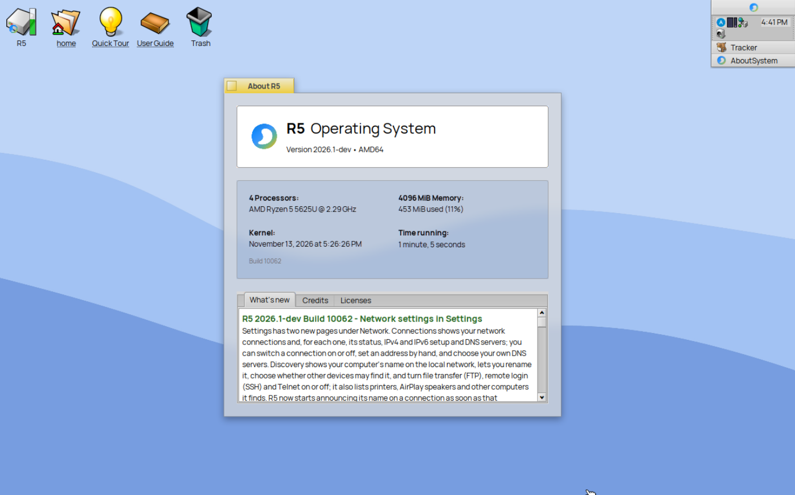

# R5 Operating System

**A desktop with a little more attitude.**

Meet R5. An independent desktop operating system built on
[Haiku](https://www.haiku-os.org/), with a fresh perspective on what a
desktop can be.

R5 brings together the things we love about a great desktop — speed,
simplicity and a sense of control — with a modern look, better
hardware support and the features you need to make yourself at home.

No unnecessary clutter. No complicated nonsense. Just a desktop that's a
pleasure to use, with plenty of personality of its own.

<p align="center"></p>

## A desktop with personality

**Same soul. Whole new attitude.**

We gave the desktop room to shine. Think floating windows, soft shadows,
frosted glass and animations that make everything feel right at home.
And yes, your graphics hardware is doing the heavy lifting. This isn't a
desktop pretending to be modern. It's R5 taking a big, beautiful step
forward.

Want a subtle look? Something with a little more depth? Or the full
glass treatment? R5 gives you three visual styles to make the desktop
feel like yours: Quiet, Balanced and Glassy.

We've also polished the everyday details. Dark mode, a more capable
notification system, improved Deskbar and Tracker behaviour, and better
touchpad support all help make the desktop feel more at home on modern
hardware.

And finding your way around system settings shouldn't be an adventure.
R5 brings them together in one place, neatly organised and easy to use.
Change something, see the result straight away, and keep it — or
switch back if you change your mind.

## Make yourself at home

**Your computer. Your space. Your rules.**

A computer is personal. It should feel that way, even when you share it.

R5 brings proper user accounts to the desktop, complete with a sign-in
screen, screen locking and separate home folders. Everyone gets their
own space, their own files and their own settings. Step away? Lock your
screen. Finished for the day? Log out. Simple.

And because not everyone needs the keys to the whole house, important
system settings stay protected. The administrator can manage the
computer without handing out unrestricted system access.

## Everything just a little more connected

**Your devices should get along. R5 helps make that happen.**

Connect to Wi-Fi, find other computers on your network, print a document
or send music to a compatible speaker. R5 is bringing the pieces of your
digital world closer together.

Network discovery makes it easier to find nearby devices and services.
Shared folders let you reach files on other computers, while support for
AirPrint and IPP makes network printing more straightforward. And when
you want your music somewhere else, R5 can send audio to AirPlay 1
speakers. AirPlay 2 is not supported yet.

Under the hood, networking has had a serious upgrade too. R5 supports
modern IPv4 and IPv6 networking, flexible DNS configuration, and Wi-Fi
drivers for MediaTek MT7921 and MT7922 hardware.

## Sound that feels right

**From a quick video to a serious session, sound matters.**

Audio should be something you enjoy, not something you have to
troubleshoot.

R5 brings more reliable USB audio, improved audio mixing and resampling,
and better handling of connected sound devices. Whether you're listening
through headphones, using HDMI audio or connecting surround speakers,
there's more room to make things sound the way you want.

And if you're particular about latency, you're in control. Choose Normal
for everyday use, Low latency when responsiveness matters, or Pro audio
for more demanding audio work.

There's attention for music makers too, with MIDI improvements, MIDI 2.0
support and a built-in MIDI monitor.

## More of your hardware, put to work

**A modern desktop deserves modern graphics.**

R5 is bringing modern graphics technology to the party, with native
Vulkan support and OpenGL support built on top of it. No Linux kernel
required.

The new desktop compositor already puts the GPU to work, making those
shadows, glass effects and smooth animations possible. On supported
hardware, that means a desktop with more depth and a more fluid feel.

There's still work to do. GPU compositor support has so far been tested
on an AMD Ryzen 5 5625U system. Other graphics hardware may use software
rendering instead, and performance can vary. We're expanding support as
development moves forward.

And don't worry about your existing apps: Haiku applications continue to
work unchanged.

## Under the hood

**The little things add up.**

A great desktop isn't just about what you see. It's also about how well
everything works together.

R5 supports AMD and Intel processors, includes AMD microcode updates and
makes smarter use of available CPU cores. It favours real and faster
cores when scheduling work, and makes better use of deeper sleep states
when your computer is idle.

It's the kind of work you might never notice directly. That's rather the
point.

## Bring R5 along for the ride

**At home on real hardware. Happy to visit a virtual machine too.**

Want to give R5 a spin without dedicating a whole computer to it? R5
includes VirtualBox Guest Additions 7.2.22 to improve the experience
when running in a virtual machine.

Existing Haiku applications continue to run unchanged, so there's no
need to leave familiar software behind.

R5 is currently developed primarily for AMD64 systems. ARM64 and RISC-V
are on the horizon, but aren't supported targets yet.

## What's coming next?

**We're not done dreaming. Not even close.**

One of the big things we're working on is GPU-powered drawing inside
application windows, using Skia.

The goal? Crisp text, smoother drawing and a more consistent visual
experience across supported hardware. It's also an important step
towards future HiDPI support.

This is still a work in progress, not a feature of the current build.
But it's a good glimpse of where we're heading.

## Project status

**A work in progress. And very much alive.**

R5 is under active development. There's no public release just yet, but
development is moving forward.

-   **Current build:** 10064
-   **Version:** 2026.1-dev
-   **Primary architecture:** AMD64

Some features are still evolving, and hardware support varies. GPU
compositor testing is currently limited to the AMD Ryzen 5 5625U system
mentioned above. Vulkan and OpenGL support are also under active
development.

## A note about R5 and Haiku

R5 is built on [Haiku](https://www.haiku-os.org/), but it is an
independent project. It is not an official Haiku distribution, nor is it
affiliated with or endorsed by the Haiku Project. See
[`distro/DISCLAIMER.txt`](distro/DISCLAIMER.txt).

Haiku provides the technical foundation for R5. We incorporate fixes
from its source tree, but changes made in R5 are not contributed back to
Haiku.

The name R5 is a nod to the history of BeOS R5. It does not mean that R5
is BeOS, a continuation of BeOS, or an official Haiku release.

Haiku and BeOS names and logos belong to their respective owners.

## For developers

Everything below is for people who build R5 or work on it.

### Trying it

R5 Operating System is built from source; there are no downloads yet. After a build (see below) you can:

- **Run it in VirtualBox.** Use [`scripts/run-vbox-r5.ps1`](scripts/run-vbox-r5.ps1) on Windows, and see [`docs/vbox.md`](docs/vbox.md). With a bridged network adapter this is the way to test real home-network features such as IPv6 and printer discovery.
- **Run it in QEMU.** Use [`scripts/run-qemu-r5.sh`](scripts/run-qemu-r5.sh). QEMU's default user-mode network is not a real home network.
- **Boot it from USB.** Build the `r5-anyboot` image and write it to a USB stick. Check the target disk twice before writing.

### Building

Haiku does not build natively on Windows. Use Linux, or WSL with Ubuntu on Windows. Keep the checkout on the Linux file system (for example `~/Projects/R5OS`), not under `/mnt/c`: the Windows file system is case-insensitive and slow for this.

Install the build tools:

```bash
sudo apt update
sudo apt install git nasm autoconf automake texinfo flex bison gawk \
  build-essential unzip wget zip xorriso mtools python3 \
  zlib1g-dev libzstd-dev
```

The full list of what Haiku needs is in [`haiku/ReadMe.Compiling.md`](haiku/ReadMe.Compiling.md).

Get the sources and Haiku's build tools, and install `jam`:

```bash
git clone https://github.com/r5-operating-system/r5os.git ~/Projects/R5OS
cd ~/Projects/R5OS
git clone https://review.haiku-os.org/buildtools
make -C buildtools/jam
(cd buildtools/jam && ./jam0 -sBINDIR="$HOME/bin" install)
export PATH="$HOME/bin:$PATH"
```

Build an image:

```bash
./scripts/build-image.sh r5-raw
```

`build-image.sh` copies the R5 Operating System changes from `distro/` into the Haiku tree, configures the build on the first run, and runs `jam`. The result lands in `haiku/generated.x86_64/`.

| Profile | Use it for |
|---|---|
| `r5-raw` | A disk image for QEMU, or for converting to a VirtualBox disk |
| `r5-anyboot` | A bootable ISO or USB stick |
| `r5-vmware` | VMware |

### How the repository is organized

| Path | What it holds |
|---|---|
| `distro/` | Everything R5 Operating System adds or changes: version, What's new, artwork, apps, drivers and system components. These files are copied into the Haiku tree at build time. |
| `haiku/` | The Haiku source tree that R5 Operating System builds on. |
| `docs/r5book/` | The R5Book, a developer guide in the style of the Be Book. |
| `docs/` | Design notes and contracts: [roadmap](docs/ROADMAP.md), [graphics](docs/GRAPHICS.md), [multi-user](docs/MULTIUSER.md), [Settings](docs/SETTINGS.md), [icons](docs/ICONS.md), [shared libraries](docs/LIBR5.md), [licensing](docs/LICENSING.md), and more. |
| `scripts/` | Build, image, virtual-machine and tracker scripts. |
| `tracker/` | Which open Haiku tickets R5 Operating System has fixed. The overview is [`tracker/STATUS.md`](tracker/STATUS.md). |
| `tools/r5-befs/` | A small read-only BeFS reader for Windows. |
| `LICENSES/` | The unmodified license texts. |

### Licensing

R5 Operating System is **multi-license**:

- Files that come from Haiku keep their original license and copyright, mostly MIT.
- New files that R5 owns are MIT, so other Haiku-based systems can use them (since 12 Nov 2026). The R5 artwork and brand files stay GPL-3.0-or-later.
- Libraries and public headers that applications link or include are MIT, so any program can use them: the R5 libraries (`libr5icons`, `libr5ui`), the R5 GPU interface header and the R5 DRM library.
- Third-party components keep their own licenses. They are listed in [`THIRD_PARTY_NOTICES.md`](THIRD_PARTY_NOTICES.md). Examples are the VirtualBox Guest Additions (GPL-3.0-only), the AMD firmware, Mesa and Skia (BSD-3-Clause).

The full policy is in [`docs/LICENSING.md`](docs/LICENSING.md). About R5 shows the licenses and credits on the system itself.

### Contributing

AI-assisted work is welcome here. It is held to the same bar as any other change: it has to build, boot and be tested before it counts as done. Before you start, read [`AGENTS.md`](AGENTS.md). It covers the development loop, the fixed parts of the system, versioning, and how to record changes.

- Pull requests target `main`.
- User-visible changes get a What's new entry in plain language. Technical details go in `CHANGELOG.md`.
- Use the name **R5 Operating System**, short **R5** (see "Name" in `AGENTS.md`). Do not use Haiku or BeOS names or logos on the image.

### Versions

Releases will be called **R5 Operating System 2026.1**, **2026.2**, and so on; a new year starts again at `.1`. Development trees carry `-dev`, and About R5 shows the version together with an increasing build number. The sources for those are [`distro/VERSION`](distro/VERSION) and [`distro/BUILD`](distro/BUILD).

Haiku's own rules for R5 work: do not open pull requests against Haiku, and do not push to Haiku's servers. Haiku does not accept AI-generated or AI-modified contributions. Open Haiku bugs are tracked in [`tracker/`](tracker/) and as GitHub issues with the `haiku` label.
